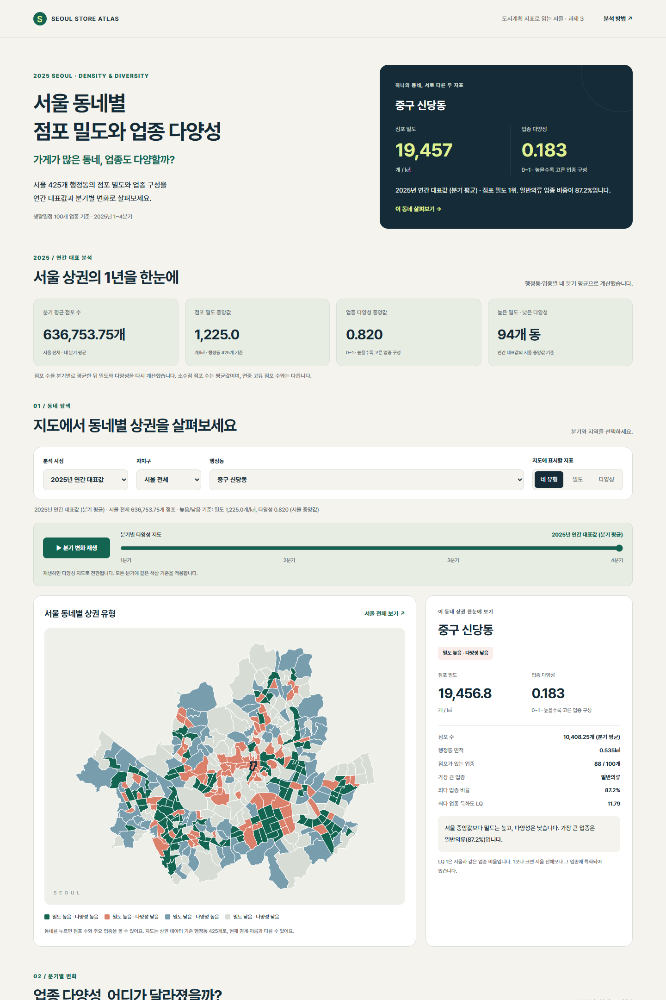

# 서울 동네별 점포 밀도와 업종 다양성

가게가 많은 동네, 업종도 다양할까?

2025년 서울 425개 행정동의 **점포 밀도와 업종 다양성**을 비교하는 과제 3 웹앱입니다.
연구 질문은 “점포 밀도가 높은 동네는 업종 구성도 다양한가?”입니다.

공개 앱: https://seoul-store-atlas.pages.dev/

GitHub 저장소: https://github.com/5ykim/seoul-store-atlas



## 실행

```sh
npm run preview
```

표시된 로컬 주소 `http://127.0.0.1:4174/`에 접속합니다. 웹페이지 파일을 직접 열면 브라우저가 데이터 읽기를 제한하므로 미리보기 주소를 사용합니다. 배포할 때는 **dist 폴더만** Cloudflare Pages에 올립니다. 앱에는 외부 라이브러리와 API 키가 필요 없습니다.

## 데이터와 분석 범위

- 점포: [서울 열린데이터광장 점포-행정동](https://data.seoul.go.kr/dataList/OA-22172/S/1/datasetView.do)의 2025년 ZIP. 사용자가 제공한 원본 사본을 `source_data/stores-2025.zip`에 보존합니다.
- 경계: [서울 열린데이터광장 영역-행정동](https://data.seoul.go.kr/dataList/OA-22160/S/1/datasetView.do)의 공식 ZIP. 서비스의 425개 코드와 모두 일치합니다.
- 출처·이용조건: 서울신용보증재단·서울 열린데이터광장, 공공누리 제1유형(출처 표시).
- 기간: 2025년 1~4분기. 기본 화면은 연간 대표값이며, 각 분기도 선택할 수 있습니다. 연간 대표값은 행정동·업종별 네 분기 점포 수의 평균으로 밀도·Entropy·LQ를 다시 계산합니다. 분기별 지수의 평균이나 연간 고유 점포 수가 아닙니다.
- 업종: 생활밀접 100개 업종. 해당 자료에 포함된 업종의 다양성이며 서울의 모든 산업이나 물리적 매장을 뜻하지 않습니다.

## 지표

1. **Density:** 전체 점포 수 / 행정동 면적(㎢).
2. **정규화 Entropy:** −Σ(pₖ ln pₖ) / ln(100). pₖ는 해당 동의 업종별 점포 비율. 업종이 없으면 0으로 포함합니다.
3. **보조 LQ:** 해당 동의 업종 비율 / 서울 전체의 같은 업종 비율. 가장 많은 업종의 특화도를 함께 보여줍니다.

원본의 `유사_업종_점포_수`는 모든 141,218행에서 `점포_수 + 프랜차이즈_점포_수`와 일치합니다. 전체 점포 수에는 이 값 하나만 사용합니다. 원본 세 열을 더하면 중복 집계됩니다.

도형 면적은 원본 EPSG:5181에서 계산합니다. 지도 표시용 12m 단순화는 면적 계산 이후 수행합니다. ‘높음/낮음’은 선택한 분석 시점의 서울 전체 425개 동의 중앙값 이상/미만으로 분류합니다. 자치구 필터를 바꿔도 이 기준은 고정합니다.

## 2025년 연간 대표 분석과 분기 변화

- 서울 분기 평균 점포 수: 636,753.75개. 소수점은 네 분기 평균에서 발생합니다.
- 연간 대표 밀도 중앙값: 약 1,225.0개/㎢. 다양성 중앙값: 약 0.820.
- 연간 대표 고밀도·저다양성: 94개 동.
- 연간 대표 피어슨 상관계수: −0.452. 스피어만 순위 상관계수: 0.087.
- 재생 버튼·슬라이더로 1~4분기 다양성 지도를 비교합니다. 색상 구간은 네 분기 서울 전체 값의 5분위로 고정하므로 같은 색은 같은 범위를 뜻합니다.
- 변화 지도는 4분기 다양성에서 1분기 다양성을 뺀 지수 차이입니다. 표시용 구간은 −0.005, 0, +0.005로 나누며 통계적 유의성 기준이 아닙니다.
- 선택한 동의 점포 수·밀도·다양성 선그래프와 상승·하락 순위를 제공합니다. 고덕2동 다양성은 약 +0.0160, 창5동은 약 −0.1398 변화했습니다. 동일 점포의 개·폐업 사유나 업종 재분류 여부까지 추적한 결과는 아닙니다.

## 2025년 4분기 결과

- 분석 대상 전체 점포: 632,830개.
- 밀도 중앙값: 약 1,215.4개/㎢, 다양성 중앙값: 약 0.821.
- 고밀도·저다양성: 93개 동.
- 신당동(중구): 10,107개 점포, 약 18,893.7개/㎢, 다양성 약 0.186. 일반의류 비율은 약 87.0%.
- 밀도와 다양성의 피어슨 상관계수: −0.446, 스피어만 순위 상관계수: 0.092. 극단값에 민감한 선형 상관과 순위 관계를 구분해야 하며, 일률적인 증가·감소 또는 인과관계를 주장하지 않습니다.

전체 결과와 해석은 [분석 보고서](docs/analysis-report.md)에 있습니다. 이 보고서는 집계 코드에서 실제 계산값을 넣어 생성합니다.

## 재현과 학습

```sh
pip install -r requirements.txt
python scripts/build_analysis.py
npm test
```

`analysis.ipynb`는 원본 읽기, 전체 점포 수 확인, 한 동의 밀도·다양성 직접 계산, 전체 계산 및 지도 출력 순서로 구성했습니다. 원본 행정동 전체가 누락되거나 코드가 불일치하면 임의의 0으로 처리하지 않고 중단합니다. 관측된 동의 업종 행이 없는 조합만 0으로 채웁니다.

노트북에는 10개 코드 셀을 실행한 표와 지도·산점도·분기별 지도·변화 지도를 저장했습니다. 연간 대표값 직접 검산도 포함합니다. 다시 실행해 출력을 저장하려면 `python scripts/execute_notebook.py`를 사용합니다.

## 주요 파일

- `dist/`: 공개 웹앱. 지도, 산점도, 동별 업종 그래프, 계산 방법 및 한계.
- `dist/data/analysis.json`: 4개 분기와 연간 대표 분석값, 업종별 점포 수.
- `dist/data/dongs.geojson`: 공식 경계를 웹 표시용으로 단순화한 지도.
- `dist/data/dong-metrics.csv`: 4개 분기와 연간 대표값 × 425개 동의 분석표. `quarter=annual`이 연간 대표값입니다.
- `scripts/build_analysis.py`: 자료 검증, 밀도·Entropy·LQ 계산, 보고서 생성.
- `source_data/`: 원본 ZIP 두 개와 출처 기록.
- `analysis.ipynb`: 수업 방식으로 따라가는 분석 노트북.
- `docs/analysis-report.md`: 연구 질문, 계산식, 결과 및 한계.
- `docs/submission.txt`: 직접 노션에 복사할 제출 내용.
- `test/data.test.mjs`: 코드 연결, 합계, 지표 재계산 검증.

## 과제 3 요구사항과 대응

| 요구사항 | 결과물 |
| --- | --- |
| 연구 질문과 분석 대상 | 앱 첫 화면·보고서 |
| 자료와 전처리 설명 | 앱 분석 방법·Python 코드·노트북 |
| 지표 2개 이상과 계산식 | Density, Entropy, 보조 LQ |
| 공간 시각화 | 행정동별 지도, 분기별 다양성 재생, 1→4분기 변화 지도 |
| 비공간 시각화 | 두 지표 산점도, 동별 업종 구성 막대그래프, 세 지표 분기별 추이 |
| 주요 결과·지역 차이·한계 | 앱 결과 해석·분석 보고서 |
| Cloudflare 공개 앱 | https://seoul-store-atlas.pages.dev/ |
| GitHub 분석 코드와 원본 자료 | https://github.com/5ykim/seoul-store-atlas |

노션 제출에 복사할 문구는 [제출 정보](docs/submission.txt)에 있습니다. 대표 이미지는 `store-atlas-preview.png`를 사용합니다.
공개 접속·기능·자료·소스와 이미지의 최종 확인 결과는 [제출 전 확인](docs/pre-submission-check.md)에 정리했습니다.

## 해석의 한계

다양성이 낮아도 전문상권의 집적이라는 장점이 있을 수 있습니다. 총면적에는 산지·하천이 포함되어 밀도에 영향을 줍니다. 전자상거래업도 포함되어 지표가 실제 보행 선택지와 같지는 않습니다. 상권 서비스의 경계·명칭을 사용하므로 상일동·일원2동 등 현재 행정동과 다른 경우가 있습니다. 매출·품질·영업시간을 분석하지 않았으며, 창업 적합도나 수익성을 평가하지 않습니다.

## Cloudflare Pages 설정

Framework preset: None / Build command: 비워 두기 / Build output directory: `dist`.
서버 코드가 없는 정적 앱이므로 환경 변수와 API 키는 필요 없습니다.

